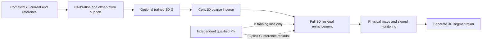

# MicroScan rebuilt pipeline

This implementation integrates the useful mechanisms of the historical CycleGAN commit `6c14ab3c376f9fee0d14bc9283bdd8e7f768f44f` and FCERNN commit `ce342caa663c24e6c344a0de056ad7c324386ef2` into the `microscan` package. Their conflicting top-level `models/data/utils` packages are not overlaid. The new production loaders require calibrated real exports. The inaccessible earlier implementation was not recovered byte-for-byte.

MSRNN means the project reconstruction stack: a Conv1D measurement-to-volume coarse inverse followed by a separate full-3D residual enhancement network. It contains **no recurrent unit**. Cole–Cole fitting is not inferred from sparse unlabelled data. The existing high-level README describes project ambitions; the contracts and executable behavior documented here govern this rebuild.

## Route and independent modules

`microscan.data` loads/scales/calibrates. `acquisition` maintains focus/scan budgets and registration checks. `subspace` offers scoped observed-support soft projection. `gan` owns independent G/F/Dx/Dy and optimizer separation. `models` owns coarse inverse, enhancement and segmentation. `pipeline` connects stage controls. `physics` owns Phi, qualification and observation-domain consistency; CycleGAN F is unrelated to Phi. `losses` keeps regression, signed change, spectral, stable-temporal, port-data and true field-equation terms distinct. `training`, `checkpoint`, `cli` and `frequency` implement orchestration and recovery.

## Fixed tensor and physical conventions

Measurements: `[B,2,F,Rx,Tx]`, channels real/imaginary; mask `[B,1,F,Rx,Tx]`. Volumes: `[B,2,Z,Y,X]`, epsilon_r and conductivity S/m at reference 0.85 GHz. Coordinates are XYZ mm; array axes ZYX. Inputs remain phase preserving and signed. Reference subtraction occurs in complex128. Scaling is one invertible observed-training RMS fitted on training geometries, not per-sample min/max. Hidden values are replaced with zero using support selection before arithmetic, including hidden NaNs. A zero amplitude with true mask is an observation. Output validity distinguishes all-missing data from assessed predictions.

The ten-slot pilot grid is fixed at `[0.60,0.65,0.70,0.75,0.80,0.85,0.90,0.95,1.00,1.05]` GHz; missing slots stay masked rather than interpolated. Port order stays physical 1–18. The pilot grid is an object ROI 120 mm wide, not a whole-head extent. Main export manifests carry verified head bounds. Target-free `inference` manifests are supported; supervised targets/labels do not become deployment requirements. See [export schema](DATA_EXPORT_SCHEMA.md).

## Exact inverse and enhancement construction

The default shared A/B inverse+enhancement construction contains **3,903,065 parameters**; segmentation contains 8,044,389, the independent full training GAN 46,310,572, and Phi 84,530. B inference has the same 3,903,065 inverse parameters as A; its external training Phi does not increase deployment count. C uses the same inverse graph with explicitly enabled residual conditioning and an external Phi dependency.

The complete leaf-layer specifications and parameter counts are generated from instantiated classes in [ARCHITECTURE_LAYERS.md](ARCHITECTURE_LAYERS.md) and [architecture_layers.json](architecture_layers.json). Regenerate with `python scripts/describe_architecture.py` from the repository root. They record convolution kernel/stride/padding/dilation/bias, normalization and directly owned parameters. The construction is untrained evidence, separate from structural runtime evidence and scientific training.

The production inverse receives six features at each frequency/Rx/Tx coordinate: real, imaginary, availability, GHz, normalized physical-order Rx label and Tx label. Flatten order is frequency, Rx, Tx. No giant dense output projection is used.

| Step | Operation and default | Ten-slot 18×18 output |
|---|---|---|
| Input | Six channels flatten only measurement axes | `[B,6,3240]` |
| Encoder 1 | Conv1D 6→32, k7/s2/p3; GroupNorm; SiLU | `[B,32,1620]` |
| Encoder 2 | Conv1D 32→32, k7/s1/p3; GroupNorm; SiLU | `[B,32,1620]` |
| Encoder 3 | Conv1D 32→64, k5/s4/p2; GroupNorm; SiLU | `[B,64,405]` |
| Encoder 4 | Conv1D 64→64, k5/s1/p2; GroupNorm; SiLU | `[B,64,405]` |
| Encoder 5 | Conv1D 64→128, k3/s2/p1; GroupNorm; SiLU | `[B,128,203]` |
| Encoder 6 | Conv1D 128→128, k3/s1/p1; GroupNorm; SiLU | `[B,128,203]` |
| Encoder 7 | Conv1D 128→256, k3/s4/p1; GroupNorm; SiLU | `[B,256,51]` |
| Encoder 8 | Conv1D 256→256, k3/s1/p1; GroupNorm; SiLU | `[B,256,51]` |
| Adapter | Adaptive average pool length32; Conv1D 256→1024 k1 | `[B,1024,32]` |
| Latent | Explicit 32768-element reshape | `[B,64,8,8,8]` |
| Decoder 1 | ConvTranspose3D 64→128, k4/s2/p1; GN; SiLU | `[B,128,16,16,16]` |
| Decoder 2 | ConvTranspose3D 128→64, k4/s2/p1; GN; SiLU | `[B,64,32,32,32]` |
| Decoder 3 | ConvTranspose3D 64→32, k4/s2/p1; GN; SiLU | `[B,32,64,64,64]` |
| Decoder 4 | ConvTranspose3D 32→16, k4/s2/p1; GN; SiLU | `[B,16,128,128,128]` |
| Readout | Conv3D 16→2 k1, invert physical scale/offset | `[B,2,128,128,128]` |

The enhancement is independent of the measurement-space GAN U-Net. Its anatomical residual U-Net uses widths 16/32/64/128 with 3×3×3 residual blocks, GroupNorm/SiLU, strided learned downsamples and transpose learned upsamples. Encoder-to-decoder skips concatenate matching grids. Symmetric crop/pad handles odd sizes, without rescaling physical axes. Inputs are coarse2, baseline2, ROI1, baseline-valid1, ROI-valid1 and mode1. Missing baseline/ROI gets explicit validity. A compact 3D measurement encoder conditions the bottleneck in A and B. The residual output is initialized near zero and multiplied by a sigmoid-bounded learned step. Default correction depth is one; 0/1/2/3 share enhancement weights. A/B use identical depth and parameter count.

The spectral property readout predicts shared slope/curvature residuals from decoder features, anchored exactly to the primary map at 0.85 GHz. This is a labelled engineering parameterization, not identifiable Cole–Cole fitting. Frequency-resolved material labels supervise it; the constant-spectrum sphere pilot does not validate head dispersion. No material-ID label is used at inference.

## GAN and segmentation

Two independent mask/frequency/port-conditioned generators use 3D residual-attention U-Nets with widths 32/64/128/256. Frequency is a signal axis, not anatomical Z. Anisotropic strides preserve short frequency depth; odd padded frequency kernels avoid the old shrinkage. Complex outputs use linear residual updates rather than unqualified Tanh saturation. Discriminators are independent 3D PatchGANs with spectral normalization. Replay buffers and distinct generator/discriminator optimizer phases preserve separation and resume. Real/fake masks share support, generated outputs are remasked, and generated values never become measured support. Paired amplitude/phase and small differential supervision apply only to aligned pairs; unpaired `y` is not a PSNR/SSIM ground truth.

The separate anatomical segmentation network is a residual U-Net with widths 16/32/64/128/256. Its nine inputs are refined2, baseline2, difference2, ROI1 and context-validity2. Default five mutually exclusive labels are healthy/background, ischemia, hemorrhage, tumor and edema. Binary and genuinely overlapping multilabel schemas are explicit alternatives. Missing clinical labels are ignored. Segmentation training initially detaches inverse predictions; controlled joint fine-tuning has an explicit freeze schedule. The pilot provides sphere object masks only.

## Physics variants and safeguards

| Setting | Reconstruction deployment | Phi behavior | Availability |
|---|---|---|---|
| A | Coarse plus measurement-conditioned enhancement | No loss/calls | Available before scientific training |
| B | Exactly the same graph/count/depth as A | Qualified frozen eval Phi only in training; input gradients retained | Requires independent paired data and passing gate |
| C | Explicit residual-conditioned correction | Compatible qualified Phi required in inference and runtime budget | Experimental, opt-in |

Phi uses a shared volume encoder and frequency/port/source/layout-conditioned complex decoder, not one unrelated network per transmitter. It cannot consume current measured targets as a copying shortcut. Qualification binds signal domain, weight identity and physical context and reports full/differential/lesion-relative/worst-support errors. No scientific Phi weights are supplied. Requested B/C must fail clearly when prerequisites are absent; synthetic fixtures do not establish headset qualification. B checkpoints record training physics provenance independently of inference requirements and can deploy without loading Phi.

The canonical background-subtracted domain name is `calibrated_delta_s`; `calibrated_delta` remains a compatibility alias. Snapshot loss compares Phi to original compatible calibrated observations, not merely GAN output. Monitoring compares `Phi(baseline+signed_change)-Phi(baseline)` to current-minus-baseline observations on intersection support with valid registration. Covariance mixing is restricted to observed support before whitening. Baseline inputs are detached for consistency. Image gradients are edge losses, never Maxwell residuals; the optional field equation interface requires actual field/source/operator/boundary data and stays disabled without them. No COMSOL solve runs inside updates.

## Monitoring, focus and optional projection

Snapshot/full-scan paths support empty-system reference subtraction. Baseline tracking uses a compatible registered same-subject acquisition and signed changes; a baseline may already contain lesions. Change sign is preserved for no-change, growth and shrinkage. Without valid baseline or absolute input, a difference-only path does not claim an absolute current volume. Measurement registration compatibility is separate from reconstructed image registration.

Focus requests come from clinicians, baseline predictions or prior frames. Observation mask, spatial assessment ROI and current supervised labels remain separate. Structured Tx/Rx/frequency failures/holdouts and explicit full-refresh/escalation are exposed. Scan exports record physical excitation/channel lists and distinguish fewer Tx excitations from post-hoc Rx discards. Reciprocity-inferred entries are not acquired observations. Outside an assessed ROI is not a confirmed negative.

Optional subspace processing fits a scoped calibration/training cohort, uses observed-support ridge projection and soft subtraction, saves its basis/context identity and retains original signal. Its complex frequency-domain formulation is an independent adaptation of temporal cohort projection. Bypass remains explicit and baseline tracking initially bypasses both GAN and subspace.

## Training, checkpoints and frequency selection

Executable stages cover GAN, independent Phi and its qualification, coarse inverse, enhancement, training-only physics, segmentation and controlled joint tuning. Objectives separately track coarse/refined property, signed-change, edge, stable-interval temporal and complex-data terms. Foreground/background weighting cannot turn current labels into inputs. Reproducible seeds, early stopping, AMP controls and complete atomic v2 checkpoints include model/optimizer/scheduler/scaler/RNG state, next-batch position, best metric, splits, architecture, scaling, frequency slots, masks and physics provenance. Incompatible historical dummy-data checkpoints are rejected and require explicit retraining/migration; they are not silently reused.

The only K-selection experiment is reconstruction plus enhancement in A, with GAN bypassed and segmentation excluded. K=3–10 uses the supplied 1-based CSV converted once, fixed ten slots, all 18 ports, matched weights count/budgets/preprocessing policy and paired seeds. Each candidate starts from scratch. Resume requires matching identity. Cases1/4 train, case2 validates, case3 remains sealed until explicit selection. Compare zero contrast and training-only mean-volume baselines, both physical property errors, balanced contrast error, localization, volume and seed variation. If ten-frequency reconstruction is not useful, report inconclusive. Otherwise select the smallest K within 5% of its validation error subject to declared localization/volume checks. Serialize selection for every subsequent stage. `configs/selected_frequencies.json` remains `pending_selection` until actual results justify a choice.

## Verification boundary and handoff

Fresh executed checks and runtime results belong in the generated verification artifacts; no historical test count is carried forward as evidence. [Production structural forwards](verification/production_forwards.json) record fresh CPU eval/no_grad outputs: MSRNN coarse/refined `[1,2,128,128,128]`, segmentation `[1,5,128,128,128]`, and 18-port GAN inputs at K3/K10. All recorded tensors were finite. The captured process peak RSS was 1,496,404 KiB; it is a CPU process measurement, not CUDA peak memory. Small-grid bounded optimizer checks test trainability and gradient routing, not generalization. Native 128³ structural forwards, when recorded, establish shape/memory feasibility for the measured host only. This environment has CPU PyTorch and no validated RTX 5070 Ti CUDA execution. Target GPU memory/AMP/latency remain unrun until the [Windows commands](WINDOWS_RUNBOOK.md) execute there. No sub-two-second or accuracy claim is made.

Main whole-head properties/clinical labels/material spectra, realistic clean/corrupted pairs, registration/source/layout exports and scientifically qualified Phi weights remain external data requirements. The prescribed order is frequency experiment → explicit freeze → agreed main data generation/export → sequential staged training. The implementation does not add COMSOL cases, dielectric-blob pretraining or a full training launch.
